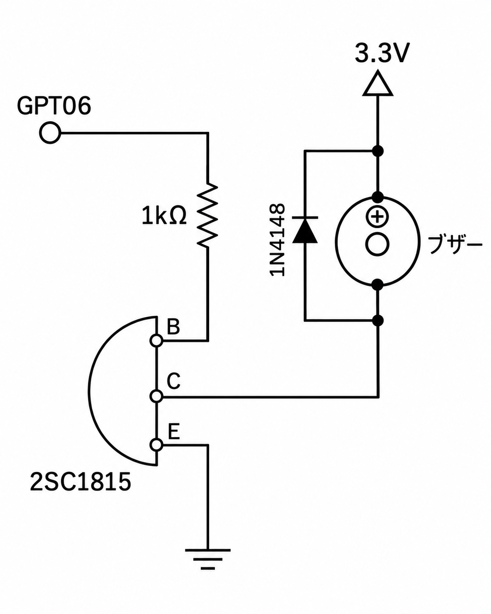

# InfoPanel

ESP32-S3 と 240x320 の液晶で作る情報表示端末。WorkingTimer とは別の端末で、タイマーより情報表示が主。

## 部品

- CPU: ESP32-S3-DevKitC-1 N16R8 (Flash 16MB / PSRAM 8MB Octal)
- 液晶: ST7789 240x320 SPI (動作確認は `..\TFT-VUMeterTester-240-320` で ESP32 を使って実施。IPS の色反転は false)

## 配線

| 液晶 | S3 の GPIO | 備考 |
|---|---|---|
| VCC | 3.3V | |
| GND | GND | |
| SCL (SCK) | 12 | |
| SDA (MOSI) | 11 | |
| CS | 10 | |
| DC | 9 | |
| RST | 8 | |
| BL | 7 | |
| SDO (MISO) | 未接続 | |

| 部品 | S3 の GPIO | 備考 |
|---|---|---|
| スイッチ 1 | 13 | もう片側は GND。内部プルアップで押すと LOW |
| スイッチ 2 | 14 | 同上 |
| スイッチ 3 | 1 | 同上。将来の拡張用 (まだ役割なし) |
| スイッチ 4 | 2 | 同上 |
| ブザー | 6 | パッシブタイプ。PWM (LEDC チャンネル 0) で鳴らし、デューティ比で音量を変える。トランジスタで駆動 (下の回路) |

### ブザー回路

- GPIO6 → 1kΩ → 2SC1815 のベース (B)。エミッタ (E) は GND。
- コレクタ (C) → ブザーの −。ブザーの + → 3.3V。
- 1N4148 をブザーと並列に、カソード (帯の側) を 3.3V 側にして入れる (コイルの逆起電力からトランジスタを守る)。
- パッシブの電磁ブザーはコイルの抵抗が小さく (16〜42Ω ほど)、GPIO から直接だと電流が多すぎるのでトランジスタを通す。
- 図の「GPT06」は GPIO6 のこと。

- S3 には GPIO23 がないため、テスト時 (ESP32: SCK18 MOSI23 CS5 DC16 RST17 BL4) とはピンが違う。
- 使わないピン: 0・3・45・46 (起動モード)、19・20 (USB)、35〜37 (Octal PSRAM が使う)、43・44 (シリアル)。

## 画面と操作

| ページ | 内容 |
|---|---|
| 01 OVERVIEW | 7 セグの時計・日付、3 台のカード (状態・ComfyUI・GPU/CPU/RAM/VRAM)、最新の出来事、今日のまとめ |
| 02 SYSTEMS | 3 台の CPU・GPU・RAM・VRAM の棒と温度 |
| 03 RENDER | ComfyUI の状態、ノード、ステップの進み、経過、速さ (s/it)、ノードの残り時間、今日のジョブ数と稼働時間 |
| 04 TRENDS | GPU 使用率と GPU 温度の 12 分間のグラフ |
| 05 SCOPE | レーダー表示 (中心から遠いほど GPU が忙しい) |
| 06 EVENTS | 出来事の記録 (接続・切断、ジョブの開始と終了、エラー、呼び出し) |
| 07 DEVICE | WiFi・MQTT・メモリなどこの端末の状態、操作の説明 |
| 08 GRAY | 液晶の残像を消すための全面表示 (上の帯も出さない)。SW1 長押しでグレー → 白 → 黒 → AUTO (10 秒ずつ順に) |

| 操作 | 動き |
|---|---|
| SW1 | 次のページ |
| SW2 | 前のページ |
| SW1 長押し (0.7 秒) | 明るさ (HIGH / MID / LOW)。08 GRAY では色の切り替え |
| SW2 長押し | 音量 (HIGH → MID → LOW → OFF の順に回る) |
| アラート中にどちらか | アラートを閉じる |

- アラート (画面中央に点滅、警告音): PC の予期せぬ切断 (`lost`)、ComfyUI の `error` / `down` / `stalled`、呼び出しベル (`doorbell/call/+` の `ON`)。正常に戻ると自動で閉じる。
- ジョブが終わると短いチャイムと画面下の通知。
- 今日のジョブ数・稼働時間は端末が起動してから数えたもので、日付が変わると 0 に戻る。

## 書き込み

- 基板の USB 端子は 2 つある。書き込みとシリアルモニタは「COM」(UART) 側を使う。
- COM 番号が決まったら `platformio.ini` の `upload_port` を書く。

## WiFi の設定

SSID とパスワードはファームウェアに書かず、起動時の設定ポータル (WiFiManager) で決める。仕組みは WorkingTimer と同じで、`include/WiFiSetup.h` は WorkingTimer と同じファイル (直すときは両方を揃える)。

1. 保存済みの WiFi につながらないと (書き込み直後など)、画面が「WIFI SETUP MODE」になり、AP `InfoPanel-XXXX` (MAC の末尾 4 桁) が立つ。
2. スマホでその AP につなぎ、設定ページ (開かなければ `192.168.4.1`) で SSID・パスワードを選んで保存する。同じページで「Device name」(任意) と「MQTT server」(初期値 `192.168.11.32`、空欄なら MQTT を使わない) も変えられる。
3. 保存すると再起動なしでつながり、いつもの画面になる。次からは自動でつながる。
4. 別の WiFi に変えたいときは **SW1 を押しながら起動 (リセット)** すると、保存済みの WiFi を消して設定モードになる。
5. 3 分たっても設定しなければ設定モードを終えてオフラインで動く (保存済みの WiFi があれば 30 秒ごとにつなぎ直す)。

ESP32 は 2.4GHz にしかつながらない。設定ページの一覧に 5GHz の SSID が出ないのは正常。

## MQTT

トピックの仕様は WorkingTimer の `MQTT_TOPICS.md` が唯一の正。新しいトピックもそこに書き足す。
クライアント ID は `InfoPanel-XXXX` (MAC の末尾 4 桁。設定ポータルの AP 名・ホスト名と同じ)。ブローカーは設定ページの「MQTT server」欄で決める。
